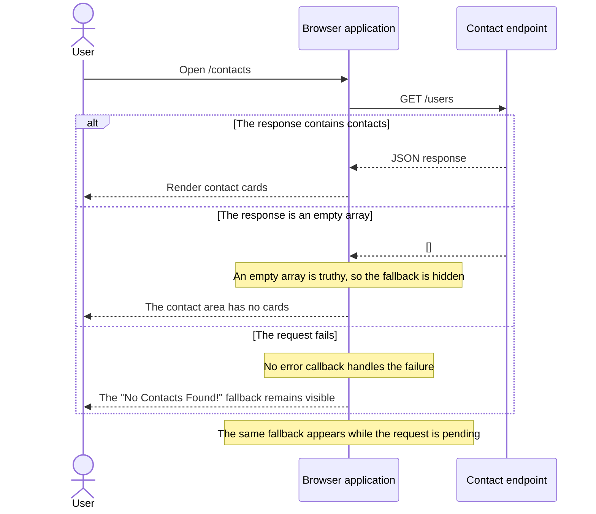

> Status: Drafted. Source claims were checked by the author. Independent review is outstanding.

# Contact-list flow

This sequence describes the route and request wired by [`app-routing.module.ts`](../../../src/app/app-routing.module.ts), [`contacts-list.component.ts`](../../../src/app/contacts/contacts-list/contacts-list.component.ts), and [`contact.service.ts`](../../../src/app/contacts/contact.service.ts).

